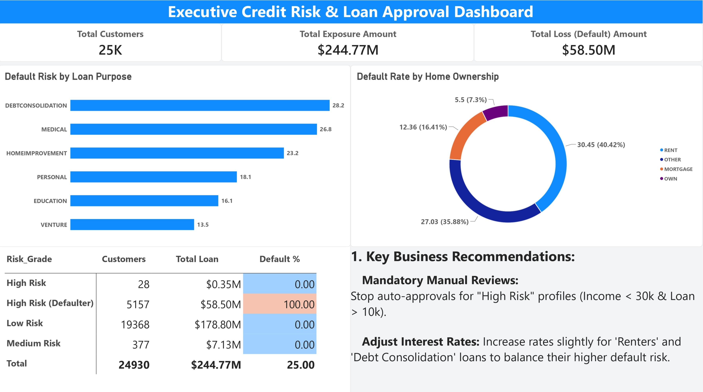

# 🏦 Bank Credit Risk & Loan Approval Analytics

## 📌 Project Overview
This project focuses on evaluating credit risk and analyzing loan approval data to identify potential defaulters. Using a dataset of 32,500+ loan applicants, I engineered a custom Risk Scoring model and developed an interactive executive dashboard to provide actionable business insights.

## 🛠️ Tech Stack Used
* **Database Management & Querying:** MySQL
* **Data Visualization & Analytics:** Power BI
* **Data Processing:** SQL (Data Cleaning, Aggregation, CASE WHEN statements)

## 📊 Key Highlights & Business Insights
1. **Custom Risk Scoring:** Segmented customers into High, Medium, and Low risk categories based on income, loan amount, and historical default status.
2. **High-Risk Exposure:** Identified that a significant portion of defaults comes from specific loan purposes like 'Debt Consolidation' and 'Medical'.
3. **Home Ownership Impact:** Analyzed that 'Renters' have a higher tendency to default compared to mortgage or home owners.

## 💡 Strategic Recommendations
* **Mandatory Manual Reviews:** Stop auto-approvals for "High Risk" profiles (Income < 30k & Loan > 10k).
* **Adjust Interest Rates:** Increase rates slightly for 'Renters' and 'Debt Consolidation' loans to balance their higher default risk.

## 📂 Repository Contents
* `Credit_Risk_Scoring_Logic.sql`: SQL scripts for data cleaning and risk grade creation.
* `Credit_Risk_Analysis_Project.pbix`: The complete Power BI dashboard file.
* `Credit_Risk_Executive_Dashboard.pdf`: High-resolution PDF report of the dashboard.
* Dataset (CSVs): Raw and aggregated data files used for analysis.

## 🖼️ Dashboard Preview

